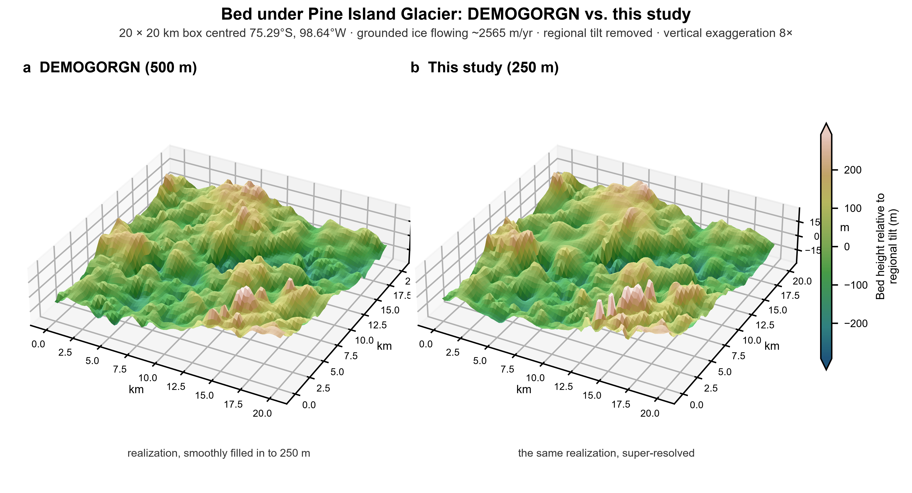
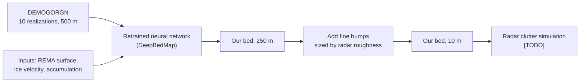
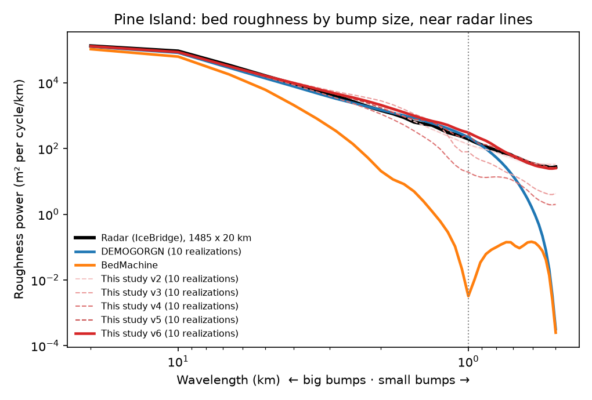
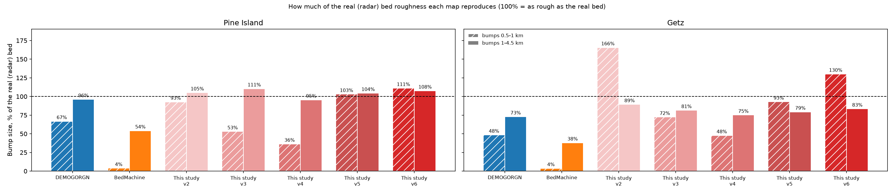
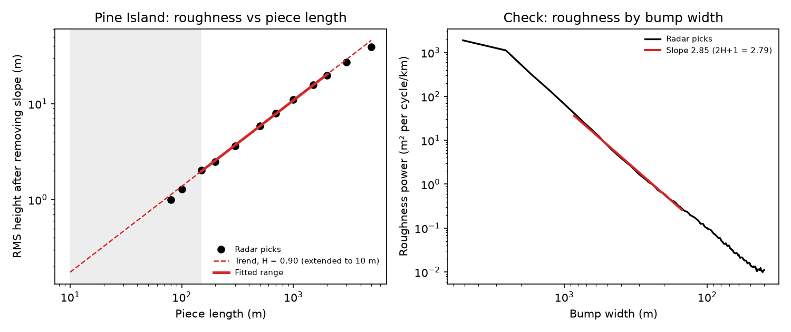
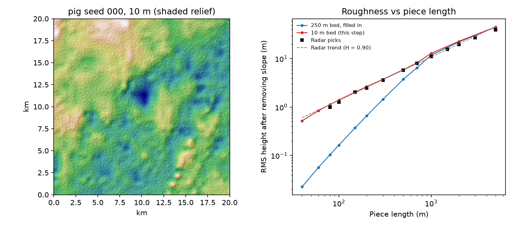
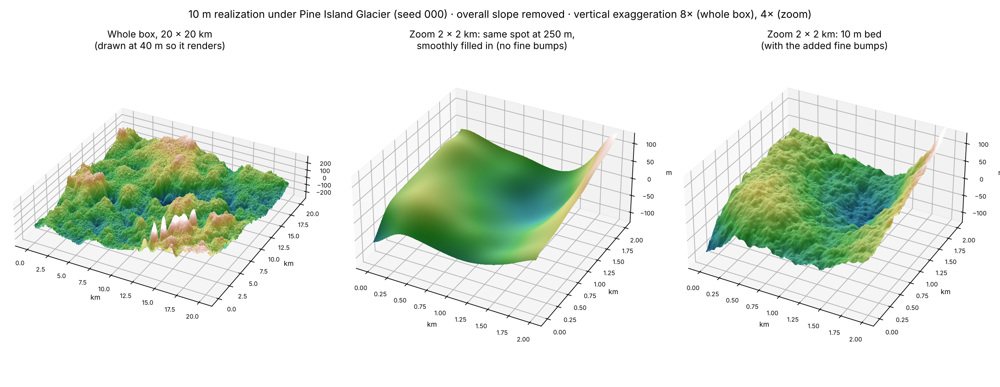

# RealisticBedMap

*Adding realistic small-scale roughness to Antarctic bed maps with a neural network, for radar clutter simulation*

> **Status: work in progress (November 2026).** The 250 m and 10 m beds are made and checked against radar. The radar clutter simulation is next; sections marked **[TODO]** are placeholders.


*The same 20 × 20 km of bed under Pine Island Glacier (75.29°S, 98.64°W): a DEMOGORGN realization (left) and the same realization super-resolved by this project (right). Overall slope removed; vertical exaggeration 8×.*

---

## Overview

Ice-penetrating radar measures the bed under the Antarctic ice sheet only along flight lines, often kilometres apart. Bed maps fill the gaps between them: **BedMachine** smoothly, and **DEMOGORGN** with many random, data-consistent realizations, both at 500 m pixels. A 500 m map can't show bumps narrower than about 1 km.

Those small bumps matter. They scatter radar energy back as **clutter** (echoes from beside the aircraft that can be mistaken for real features), and they affect basal drag and meltwater routing. So radar sounder simulators and other applications need beds with realistic sub-kilometre roughness, even where nobody has measured it.

This project:

1. **Super-resolves DEMOGORGN from 500 m to 250 m** with a neural network ([DeepBedMap](https://github.com/weiji14/deepbedmap); Leong & Horgan, 2020) retrained for realism. Its roughness is matched to IceBridge radar, and its texture to real glacier-carved seafloor.
2. **Extends the beds to 10 m** by adding fine bumps whose roughness follows the trend measured by radar along flight lines.
3. **[TODO]** Runs a radar sounder simulator over DEMOGORGN and the new beds to compare predicted clutter.

Study areas: **Pine Island Glacier** (74–78°S, 85–105°W) and the **Getz Ice Shelf** region (73.5–77°S, 114–136°W), West Antarctica.

## How it works



- **Large-scale shape stays DEMOGORGN's.** Every 1 km square of the output averages to the same height as DEMOGORGN. Near radar lines, where all realizations agree, DEMOGORGN's 500 m detail is also kept. The network only adds the bumps DEMOGORGN can't show.
- **Training for realism.** The network was first fine-tuned on Pine Island IceBridge radar, then retrained so that:
  - its roughness at each bump size (4.5 km down to 0.5 km) matches the radar;
  - two "judge" networks can't tell its texture from real seafloor that was once under glaciers (GMRT multibeam, Pine Island Bay and the Getz troughs);
  - its mix of flat ground and steep features matches the seafloor's.

  It trains on 118 × 118 km windows and grades only the central 36 km, so training sees exactly what the final maps contain.
- **10 m detail.** The radar picks are about 15 m apart along each flight line. Cutting the lines into pieces from 80 m to 5 km and measuring how bumpy each length is gives a power law (Hurst exponent *H*). Random detail with that roughness is added below 500 m, in boxes around the areas to simulate.

## Results so far

**Realism at 250 m.** Roughness of 0.5–1 km bumps as a % of the radar-measured bed (100% = as rough as the real bed):

| | BedMachine | DEMOGORGN | **This study** |
|---|---|---|---|
| Pine Island | 4% | 67% | **111%** |
| Getz (not used in training) | 4% | 48% | **130%** |


*Roughness at each bump width near IceBridge lines, Pine Island. Our bed (solid red) follows the radar (black) down to 0.5 km; DEMOGORGN (blue) drops off below about 1 km, its pixel limit; BedMachine (orange) is far smoother. Dashed lines are earlier versions of the model.*


*Bump size as a % of the radar bed for 0.5–1 km (hatched) and 1–4.5 km (solid) bumps, for every version of the model.*

**Roughness below 250 m (from radar).** At Pine Island (37,760 km of flight line), roughness follows one power law from 150 m to 2 km, with *H* = 0.90; at Getz, *H* = 0.97. A second method (the slope of the roughness spectrum) agrees: 2.85 vs the predicted 2*H* + 1 = 2.79.



**Validation of the 10 m beds.** Ten 10 m realizations of a 20 × 20 km box on fast-flowing Pine Island ice follow the radar's roughness trend from 5 km down to 40 m. The same bed simply interpolated to 10 m is about 25 times too smooth at the smallest scale.




*Left: the whole 20 km box at 10 m. Middle and right: a 2 km zoom without and with the added fine bumps.*

**[TODO] Radar clutter.** Simulated radargrams along a Pine Island flight line over DEMOGORGN vs our 10 m beds, compared with the real IceBridge radargram.

**Known limitations**
- Slightly too rough at the smallest 250 m scales, especially at Getz (130%).
- Bumps are spread evenly, rather than as flat areas between sharp ridges like real glacier beds.
- Below about 100 m the radar can't check roughness, so the 10 m detail extends the measured trend. Its bumps are random in shape, with no flow alignment.

---

## Environment

Python 3.11+. With conda:

```bash
conda env create -f environment.yml
conda activate realisticbedmap
```

or with pip: `pip install -r requirements.txt`.

A GPU is strongly recommended for training. The fine-tuning step ran on a Google Colab T4, and the realism training on an NVIDIA RTX 5070 Ti. For new NVIDIA cards, install PyTorch from [pytorch.org](https://pytorch.org) with the matching CUDA build.

## Data

Download these into the project folder (none are included in this repository):

| Data | Where to get it | Put it in |
|---|---|---|
| DEMOGORGN realizations | Downloaded automatically from the [source.coop icechunk store](https://data.source.coop/englacial/demogorgn/icechunk/realizations.icechunk) by `get_demogorgn.py` | (created) |
| BedMachine Antarctica v3 | [NSIDC-0756](https://nsidc.org/data/nsidc-0756) | `raw/NSIDC-0756_4-…/` |
| MEaSUREs ice velocity | [NSIDC-0484](https://nsidc.org/data/nsidc-0484) | `raw/NSIDC-0484_2-…/` |
| REMA 100 m mosaic v2.0 | [Polar Geospatial Center](https://www.pgc.umn.edu/data/rema/) | `raw/rema_mosaic_100m_v2.0_filled_cop30_dem.tif` |
| IceBridge MCoRDS bed picks (IRMCR2) | [NSIDC IRMCR2](https://nsidc.org/data/irmcr2), clipped to the two study boxes | `icebridge_pig/`, `icebridge_getz/` |
| Snow accumulation | AMSR-based map, as used by DeepBedMap | `amsr_accumulation_map.txt` |
| Seafloor (realism reference) | [GMRT MapTool](https://www.gmrt.org/GMRTMapTool/), "topo-mask" grids of Pine Island Bay and the Getz troughs | `realbeds/pine_island_bay.tif`, `realbeds/getz_troughs.tif` |
| Pretrained DeepBedMap weights | [Zenodo 4054246](https://doi.org/10.5281/zenodo.4054246) | `srgan_generator_model_weights.npz` |

## Usage

Run the scripts in this order from the project folder. Each one's header lists exactly what it needs and makes.

**1. Prepare the data**
```bash
python get_demogorgn.py               # DEMOGORGN mean/std for both regions
python get_demogorgn_realizations.py  # 10 individual realizations -> demogorgn_real/
python crop_inputs.py                 # REMA, velocity, BedMachine on the same grid -> cropped/
python grid_radar.py                  # IceBridge radar onto the 250 m grid -> cropped/
python build_tiles.py                 # model inputs and training tiles -> tiles/
python prep_realism.py                # seafloor patches + realizations for training -> tiles/
```
Then copy the `.npz` files from `tiles/` into the project folder. The training and map-making scripts read them from there.

**2. Train**
```bash
python train_deepbedmap.py    # fine-tune on Pine Island radar -> finetuned_deepbedmap.pt
python measure_targets.py     # radar roughness targets -> roughness_targets.json
python train_realism_v5.py    # realism training, full-context windows -> realism_v5.pt
python train_realism_v6.py    # + DEMOGORGN 500 m detail, shape judge, slope rule -> realism_v6.pt
```

**3. Make the 250 m beds and figures**
```bash
python make_realizations.py realism_v6.pt   # 10 beds per region at 250 m -> realizations_v6/
python make_figures.py                      # roughness spectra, bar chart, profiles, 3D -> figures/
python make_class_figure.py                 # DEMOGORGN vs this study in 3D -> figures/
```

**4. Make the 10 m beds**
```bash
python measure_fine_roughness.py             # radar roughness vs piece length -> fine_roughness.json
python make_fine_bed.py res=10               # 20 x 20 km box at 10 m, all realizations -> fine_beds/
python make_fine_bed.py res=10 lat=-75.29 lon=-98.64 size=20   # choose the box
```
Outputs are GeoTIFFs in Antarctic polar stereographic (EPSG:3031), in metres, with the same height reference as DEMOGORGN. That's the format the radar sounder simulator reads.

**5. [TODO] Radar clutter simulation** with the [englacial radar-sounder-simulator](https://github.com/englacial/radar-sounder-simulator).

## Repository layout

```
README.md, environment.yml, requirements.txt, LICENSE
figures/                    figures shown in this README
deepbedmap_torch.py         DeepBedMap rebuilt in PyTorch (loads the original weights)
roughness.py, match500.py   shared roughness measures; pulling output onto DEMOGORGN
get_*.py, crop_inputs.py, grid_radar.py, build_tiles.py, prep_realism.py   data preparation
train_*.py, measure_targets.py                                             training
make_*.py, measure_fine_roughness.py                                       beds and figures
```

## References

- Leong, W. J., & Horgan, H. J. (2020). DeepBedMap: a deep neural network for resolving the bed topography of Antarctica. *The Cryosphere, 14*, 3687–3705.
- Morlighem, M., et al. (2020). Deep glacial troughs and stabilizing ridges unveiled beneath the margins of the Antarctic ice sheet. *Nature Geoscience, 13*, 132–137.
- Ryan, W. B. F., et al. (2009). Global Multi-Resolution Topography synthesis. *Geochemistry, Geophysics, Geosystems, 10*, Q03014.
- Bingham, R. G., et al. (2017). Diverse landscapes beneath Pine Island Glacier influence ice flow. *Nature Communications, 8*, 1618.
- Gerekos, C., et al. (2023). The phase response of a rough rectangular facet for radar sounder simulations of both coherent and incoherent scattering. *Radio Science, 58*(6), e2022RS007594.
- DEMOGORGN: **[TODO: citation]**

## Acknowledgments

**[TODO]** Dr. Emma "Mickey" MacKie (course instructor) and the englacial team for DEMOGORGN and the radar sounder simulator.
